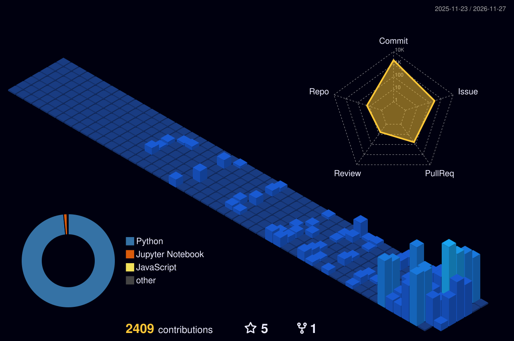

  

  

## Research Interests

I explore how AI agents can reason, search, verify, and revise their decisions more effectively, with a particular interest in mathematical reasoning and causality.

  
  
  
  

## Featured Research Projects

<table>
  <tr>
    <td width="50%" valign="top">
      <h3><a href="https://github.com/RUSS0718/RiCL">RiCL</a></h3>
      
<strong>Reasoning in the Causal Loop</strong>

      
A causality-inspired research prototype for multi-agent mathematical reasoning, with explicit dependencies, independent verification, and adaptive search.

      
      
    </td>
    <td width="50%" valign="top">
      <h3><a href="https://github.com/RUSS0718/RiCL-experiemnt">RiCL Experiments</a></h3>
      
<strong>Empirical Studies in Agent Reasoning</strong>

      
Companion experimental repository for RiCL, including motivation studies on agent reasoning.

      
      
    </td>
  </tr>
</table>

## Tech Stack

  

## 3D Contribution Activity

  <picture>
    <source media="(prefers-color-scheme: dark)" srcset="./profile-3d-contrib/profile-night-view.svg" />
    <source media="(prefers-color-scheme: light)" srcset="./profile-3d-contrib/profile-season.svg" />
    
  </picture>

  <a href="https://github.com/yoshi389111/github-profile-3d-contrib">GitHub Profile 3D Contrib</a> · Updated daily

  <em>From trial and error to intelligent exploration.</em>

